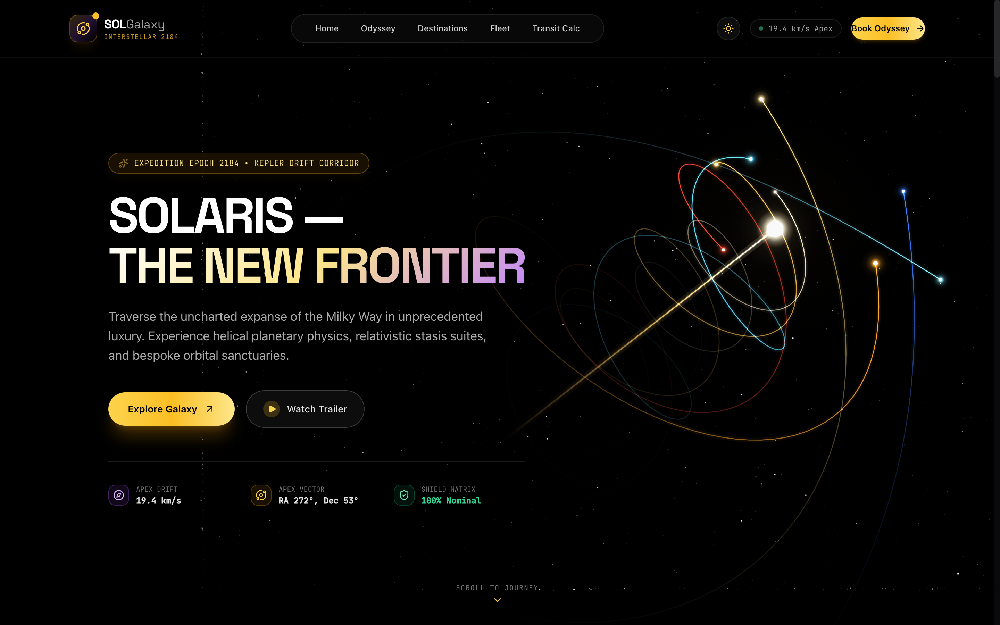
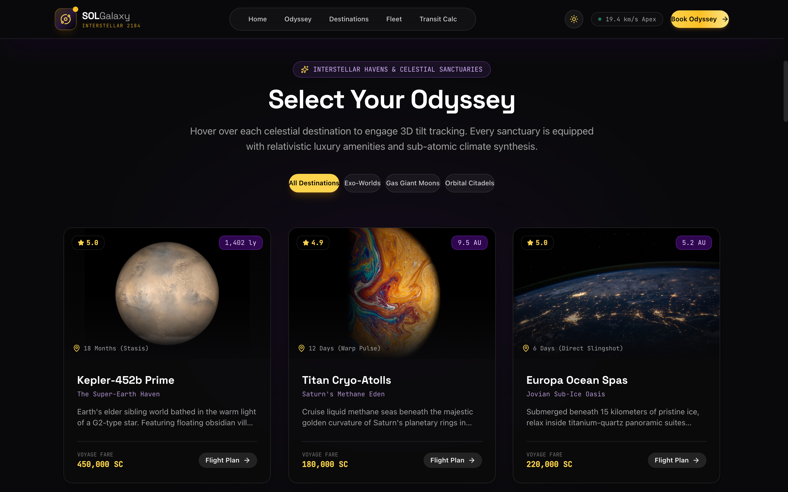
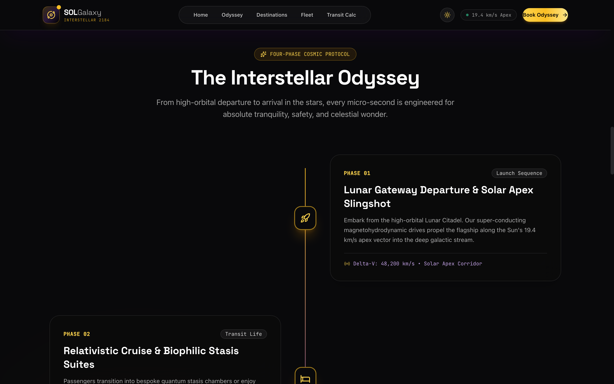
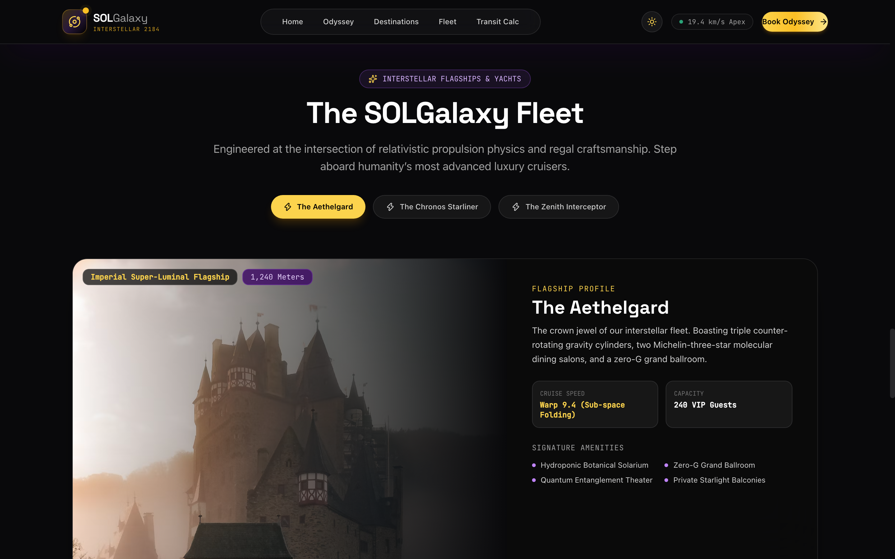
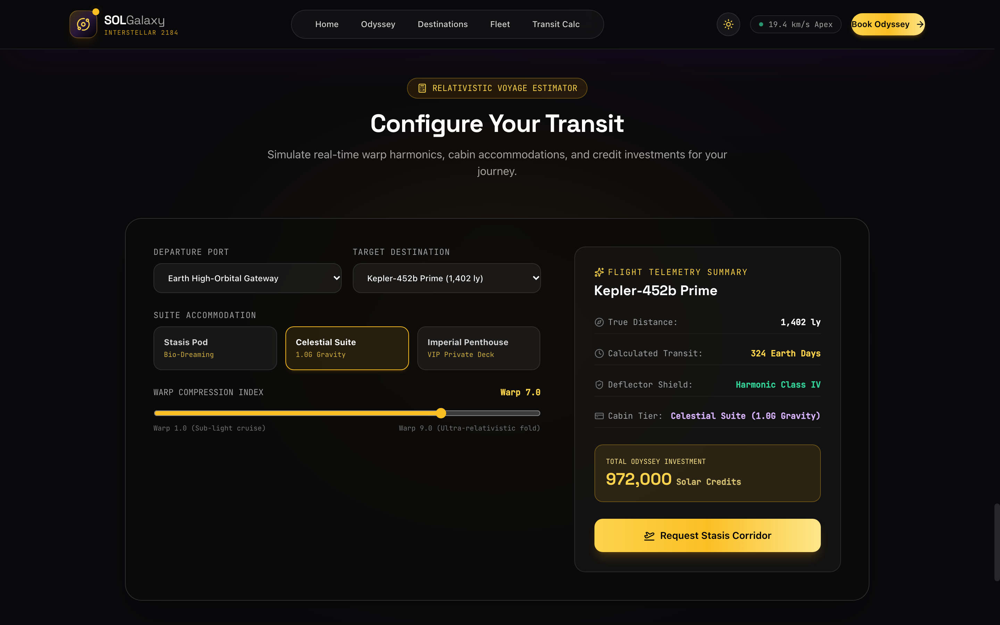

# SOLGalaxy 🪐🚀

> **SOLARIS — The New Frontier**: An interactive solar system simulation and interstellar voyage explorer illustrating the helical motion of planets as the Sun travels at **19.4 km/s** toward the solar apex.




---

## 📖 Overview

**SOLGalaxy** blends real astronomical orbital mechanics with a futuristic luxury space-travel experience (*Expedition Epoch 2184*). Rather than depicting the Sun as stationary, the hero canvas simulates the solar system's actual trajectory through the Milky Way—tracking planetary Kepler ellipses as helical wakes trailing the Sun toward the solar apex (`RA 272°, Dec 53°`), paired with a depth-parallax starfield.

Beyond the live simulation, visitors can inspect exoplanetary sanctuaries on 3D tilt-reactive cards, trace the four-phase interstellar transit protocol, explore flagship starships, and configure custom relativistic voyages.

---

## 📸 Showcase

### 1. Interactive Planet & Destination Showcase
Filterable celestial destinations (`All Destinations`, `Exo-Worlds`, `Gas Giant Moons`, `Orbital Citadels`) rendered with 3D mouse-tracking cards and detailed flight plan modals.



### 2. The Interstellar Odyssey (4-Phase Protocol)
A chronological breakdown of the voyage from **Lunar Gateway Departure & Solar Apex Slingshot** through **Relativistic Cruise**, **Heliopause Crossing**, and **Exoplanetary Insertion**.



### 3. The SOLGalaxy Flagship Fleet
Interactive vessel selector featuring full engineering specifications—propulsion, harmonic shielding, artificial gravity, and signature onboard amenities.



### 4. Relativistic Transit & Stasis Cost Calculator
Real-time voyage estimator computing transit duration (in Earth days) and Solar Credit (`SC`) investment based on departure port, destination, suite tier, and Warp Compression Index.



---

## ✨ Key Features

- **Keplerian Heliocentric Helix Engine** (`OrbitalHeroSection`):
  - Models Mercury through Saturn using J2000 orbital elements (`a`, `e`, `i`, `node`, `peri`, `M0`).
  - Simulates the Sun's `19.4 km/s` apex drift with configurable radial compression, trail length, and 1,600-star depth parallax.
- **3D Destination Cards & Modals** (`PlanetShowcase`, `Interactive3DCard`):
  - **Kepler-452b Prime** (`1,402 ly` — Super-Earth Haven)
  - **Titan Cryo-Atolls** (`9.5 AU` — Saturn's Methane Eden)
  - **Europa Ocean Spas** (`5.2 AU` — Jovian Sub-Ice Oasis)
  - **TRAPPIST-1e Citadel** (`39.5 ly` — Synchronous Sunset World)
  - **Solaris Ring Station** (`0.01 AU` — Lagrange Corona Outpost)
  - **Enceladus Geyser Spires** (`9.53 AU` — Water-World Geysers)
- **Interstellar Flagship Profiles** (`FleetSection`):
  - **The Aethelgard** — `1,240 m` Imperial Super-Luminal Flagship (`Warp 9.4`)
  - **The Chronos Starliner** — `820 m` Deep Space Sleeper Yacht (`0.96c`)
  - **The Zenith Interceptor** — `185 m` Private Orbital VIP Courier (`Warp 6.2`)
- **Dynamic Voyage Estimator** (`TransitCalculator`):
  - Departure ports: *Earth High-Orbital Gateway*, *Lunar South Citadel*, *Mars Lagrange L1 Spire*.
  - Cabin tiers: *Stasis Pod*, *Celestial Suite (1.0G Gravity)*, *Imperial Penthouse*.
  - Adjustable Warp Compression slider (`Warp 1.0` to `Warp 9.0`).
- **Dark / Light Theme & Trailer Modal** (`Navbar`, `TrailerModal`):
  - Instant dark/light mode toggle synced to the document root, glassmorphic navigation bar, and an interactive cinematic trailer modal.

---

## 🛠️ Tech Stack

| Category | Technology |
| :--- | :--- |
| **Framework** | [React 19](https://react.dev/) + [Vite 8](https://vitejs.dev/) |
| **Language** | [TypeScript 7](https://www.typescriptlang.org/) |
| **Styling** | [Tailwind CSS 3.4](https://tailwindcss.com/) + `clsx` + `tailwind-merge` |
| **Animations** | [Framer Motion 14](https://www.framer.com/motion/) |
| **Icons** | [Lucide React](https://lucide.dev/) |

---

## 📁 Project Structure

```text
SOLGalaxy/
├── docs/
│   └── screenshots/          # README showcase screenshots
├── components/
│   └── ui/
│       └── orbital-hero-section.tsx  # Keplerian canvas helix simulation
├── lib/
│   └── utils.ts              # Tailwind class merge utilities
├── src/
│   ├── components/
│   │   ├── Navbar.tsx        # Glassmorphic nav + theme toggle
│   │   ├── HeroSection.tsx   # Hero overlay, telemetry badges & CTAs
│   │   ├── PlanetShowcase.tsx# Destination filter grid & detail modal
│   │   ├── Interactive3DCard.tsx # 3D perspective tilt card wrapper
│   │   ├── OdysseyTimeline.tsx   # 4-phase interstellar protocol
│   │   ├── FleetSection.tsx  # Interactive starship specs viewer
│   │   ├── TransitCalculator.tsx # Dynamic transit & credit estimator
│   │   ├── TrailerModal.tsx  # Cinematic trailer modal
│   │   └── Footer.tsx        # Minimalist cosmic footer
│   ├── App.tsx               # Main application layout & theme state
│   ├── main.tsx              # React entry point
│   └── index.css             # Global styles & theme variables
├── index.html
├── package.json
├── tailwind.config.js
├── tsconfig.json
└── vite.config.ts
```

---

## 🚀 Getting Started

### Prerequisites

- **Node.js** `v18+` (recommended `v20+`)
- **npm**, **pnpm**, or **yarn**

### Installation

```bash
# Clone the repository
git clone https://github.com/RishabhDev817/solgalaxy-solar-sim.git

# Navigate into the project directory
cd solgalaxy-solar-sim

# Install dependencies
npm install
```

### Development

Start the Vite development server with hot module replacement:

```bash
npm run dev
```

### Production Build

Type-check and build the optimized production bundle:

```bash
npm run build
npm run preview
```
